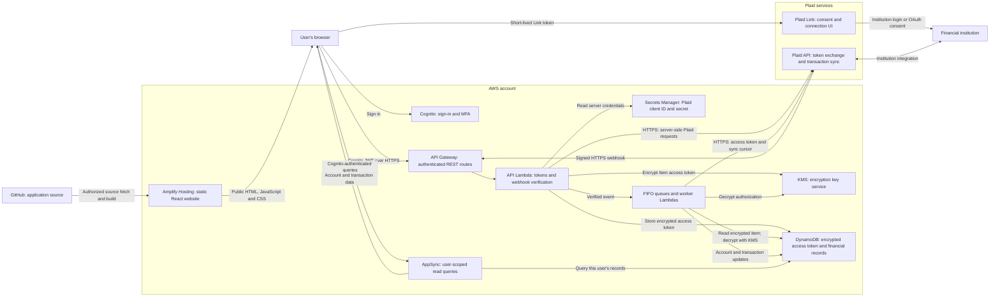
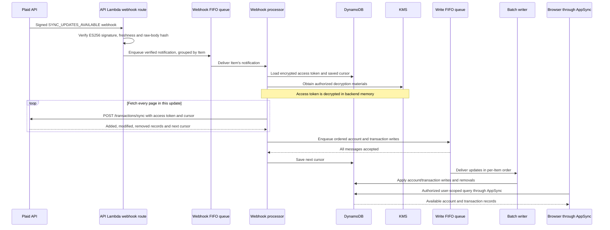

# Current secure data flow: Amplify, AWS and Plaid

Updated **November 11, 2026**. This supplemental README explains the modernized repository's design and where its credentials and transaction data travel. The application has passed local/container checks; **the AWS application and complete live Plaid flow have not been deployed and verified**. See the [setup guide](README.md) and [predeployment review](doc/PREDEPLOYMENT.md) for operational steps.

## The overall picture

**Amplify serves the website. AWS runs the application backend. Plaid connects to the financial institution.** Amplify Hosting does not need the Plaid secret or a bank access token to build the frontend.



The diagram separates responsibilities; AWS worker arrows represent several components, not a single direct queue-to-Plaid connection. All Plaid API calls are made by Lambda code. The same API Lambda receives the public webhook route and verifies its Plaid signature; that route uses webhook verification rather than requiring a user's Cognito login.

GitHub access lets Amplify retrieve source for hosting. It does not give GitHub the backend's Plaid credentials. The template enables automatic frontend builds on the configured branch, so a source push can publish the website **after** hosting is connected. SAM deployment is a separate infrastructure operation.

## Which token or key means what?

“Transaction key” can refer to several different things. This integration uses an **Item access token** to authorize financial-data requests; individual transaction IDs identify records.

| Value | What it does | Where this implementation uses it |
| --- | --- | --- |
| Plaid client ID and environment-specific secret | Authenticate this application to Plaid | Secrets Manager, read by authorized backend Lambdas; never frontend build variables |
| `link_token` | Initializes a short-lived Plaid Link session | Created by the backend and returned to the browser; kept in tab session storage to resume OAuth, then cleared on success/exit |
| `public_token` | One-time result of a successful Link connection, exchanged for an Item access token | Travels from Plaid Link to the browser and immediately to the authenticated token-exchange route |
| `access_token` | Authorizes server-side requests for the connected Item | Returned by Plaid to the backend; encrypted before DynamoDB storage; decrypted in backend memory when needed |
| Cognito JWT | Identifies the signed-in application user | Browser requests to API Gateway/AppSync; distinct from every Plaid token |
| KMS key / encryption materials | Protect the stored Plaid access-token attribute | KMS and the DynamoDB encryption client; these keys are not browser credentials or Plaid transaction IDs |
| Plaid webhook verification public key | Checks that a webhook was signed by Plaid | Backend verification cache; Plaid retains its signing private key |
| Sync cursor | Records the position in the Item's transaction-update stream | Backend DynamoDB Item record; sent on the next sync request |
| Item, account and transaction IDs | Identify the connection and financial records | Backend records and permitted UI/query data; IDs alone do not authorize access |

The Plaid secret and access token must remain confidential even though the client ID is an application identifier. Link/public tokens should also be handled as sensitive transient values. Official explanations: [Plaid Link flow](https://plaid.com/docs/link/) and [Plaid token endpoints](https://plaid.com/docs/api/items/).

## Initial connection: how the backend obtains an access token

```mermaid
sequenceDiagram
  actor User
  participant Browser as Browser / Amplify-hosted React
  participant Auth as Cognito
  participant API as API Gateway and API Lambda
  participant Secret as Secrets Manager
  participant Link as Plaid Link
  participant Plaid as Plaid API
  participant Crypto as Encryption client and KMS
  participant DB as DynamoDB

  User->>Browser: Choose Connect with Plaid
  Browser->>Auth: Establish signed-in session with MFA
  Browser->>API: GET /v1/tokens with Cognito JWT
  API->>API: Identify user from authenticated subject
  API->>Secret: Read server-side Plaid credentials
  API->>Plaid: Create Link token for this user and Transactions
  Plaid-->>API: link_token
  API-->>Browser: link_token
  Browser->>Link: Initialize Link with link_token
  User->>Link: Select institution and complete consent/login
  Link-->>Browser: public_token after success
  Browser->>API: POST /v1/tokens with public_token and JWT
  API->>Plaid: Exchange public_token using server credentials
  Plaid-->>API: access_token and item_id
  API->>Crypto: Encrypt and sign access_token attribute
  Crypto-->>API: Encrypted Item representation
  API->>DB: Store encrypted token and user/Item lookup records
  API-->>Browser: 202 Accepted; Item location, no access_token
  Note over API,DB: A filtered Item INSERT stream starts asynchronous synchronization
```

The browser does not receive the Item access token. The backend does not collect bank passwords through its own REST endpoints; institution authentication is handled through Plaid Link and the institution's supported login/OAuth flow. Plaid documents this Link-to-public-token-to-access-token exchange; this repository adds its own AWS storage and authorization design.

The primary implementation is in [the token routes](backend/api/app/routers/tokens.py), [the browser Link integration](frontend/src/components/Plaid.jsx) and [backend Plaid client setup](backend/api/app/utils.py).

## Transaction updates: notifications, data and ordering



A webhook is a **notification to fetch updates**, not an access token or the complete transaction history. The worker uses its stored access token to call Plaid. API credentials and access tokens are not included in the queue messages; the write queue carries financial records, while the webhook queue carries notifications and Item/user routing identifiers.

Initial synchronization starts from a filtered DynamoDB Item insertion. That stream handler puts an initialization message into the same per-Item webhook FIFO group. This keeps initial sync and later notifications serialized for an Item.

The worker collects all pages before queuing writes. If Plaid reports that data changed during pagination, it retries from the original cursor and discards the incomplete collection. The cursor advances only after SQS accepts all messages; DynamoDB writes happen afterward. Partial enqueue failure causes retry. The writer recognizes removals and deletes those records. See [Plaid Transactions Sync](https://plaid.com/docs/api/products/transactions/) and the [sync worker](backend/webhook_processor/app/products/transactions.py).

FIFO queues preserve order per Item, but the cursor and queued writes are not one atomic database transaction. Repeated failures reach DLQs; replaying an old update after a newer one requires reconciliation. The UI may need **Reload accounts and transactions** while asynchronous processing finishes.

## Security boundaries and practical limits

- **Authentication:** API Gateway and AppSync validate application-user authentication. Backend keys and resolver queries use Cognito `sub` to scope records. This does not establish that deployed authorization is correct until live isolation tests pass.
- **Token storage:** the DynamoDB encryption client encrypts/signs the `access_token` attribute using KMS-backed materials. Other fields use the configured default action and are not all application-level encrypted.
- **Financial-data storage:** DynamoDB and SQS have server-side encryption enabled. Account and transaction fields are available in plaintext to authorized application code and the permitted UI. Storage encryption does not replace IAM, query isolation, retention policy or careful logging.
- **Transport:** public browser/API/Plaid traffic uses HTTPS in the deployed flow. Local Vite development uses loopback HTTP; production TLS is terminated by the managed services.
- **Webhooks:** the unauthenticated public route accepts data only after this implementation verifies the Plaid signature, token age and request-body digest. See [Plaid webhook verification](https://plaid.com/docs/api/webhooks/webhook-verification/) and [the verification code](backend/api/app/routers/webhook.py).
- **Browser configuration:** endpoints, Region and Cognito pool/client identifiers are public configuration. Plaid secrets, access tokens, AWS credentials and GitHub PATs must never be put into frontend environment variables or source control.
- **Logging:** event logging and Lambda response capture are disabled on the relevant handlers to reduce token exposure. Continue reviewing logs and error paths; these settings are not a full security audit.
- **Connection removal:** the authenticated DELETE route revokes the Plaid Item before local deletion. Deleting AWS infrastructure alone does not revoke Plaid access.

This is an implementation explanation aligned with Plaid's documented token and sync flows. Its AWS encryption choices are application design decisions; the diagram is not a Plaid certification, compliance assessment or proof of production readiness. The complete live Link, OAuth, webhook, IAM/KMS and user-isolation checks remain listed in [the predeployment review](doc/PREDEPLOYMENT.md).
