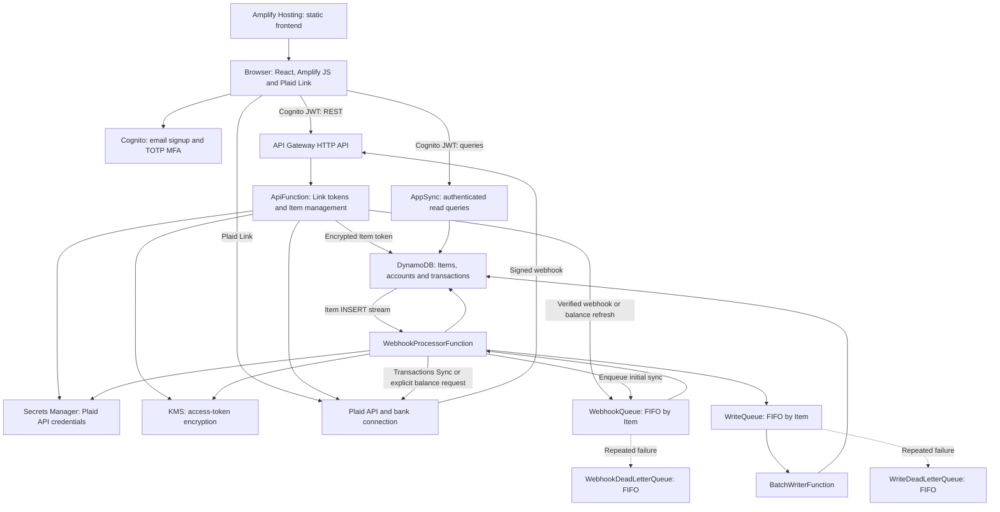
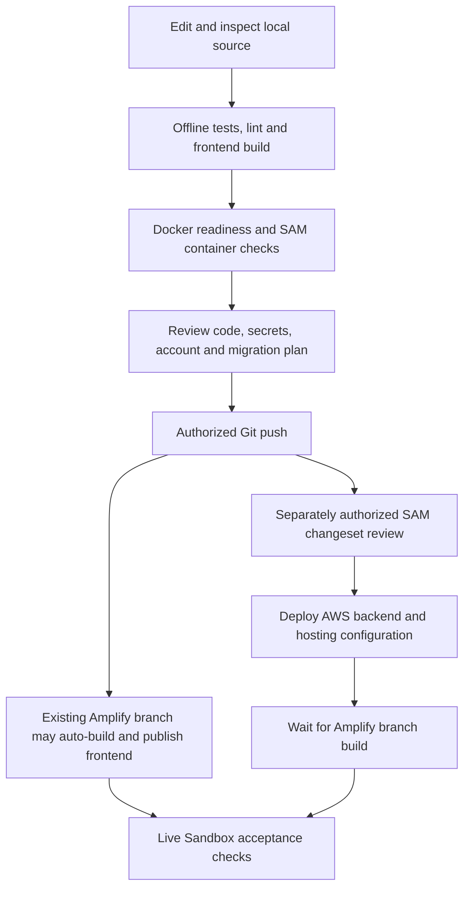
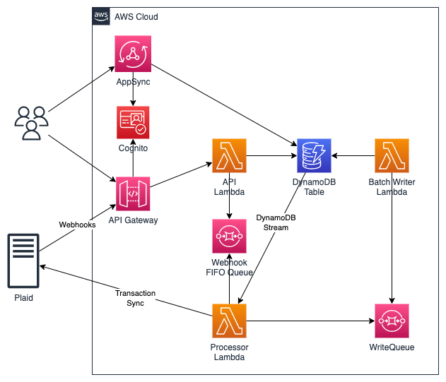

> **Predeployment refresh (2026-11-10):** Docker/SAM container builds, local Lambda smoke checks and six AppSync service evaluations now pass. See [the current predeployment review](doc/PREDEPLOYMENT.md) for exact scope, target, credential helper, blockers and future deployment commands. No AWS deployment has occurred. The older results below remain a historical record.

# AWS Plaid Modern — setup, run and deployment guide

This guide documents the modernized repository as of **2026-11-10**. It is prepended for review and manual merging. **The complete README that existed before this addition is preserved verbatim after the “Preserved previous README” divider.** The [modernization audit](doc/MODERNIZATION.md) records implementation findings and the earlier validation results.

The application retains **AWS SAM/CloudFormation for infrastructure** and **Amplify Hosting for the React frontend**. Getting local builds to pass does not verify the deployed application. Credentials and local logins may already be configured on your device; use those existing profiles and secure stores, check their account/environment, and never paste their contents into this README or commit them.

## Guide contents

1. [Architecture and repository map](#architecture-and-repository-map)
2. [Toolchain and Docker Desktop](#toolchain-and-docker-desktop)
3. [Install dependencies and run local checks](#install-dependencies-and-run-local-checks)
4. [Account, Region, Plaid and secret configuration](#account-region-plaid-and-secret-configuration)
5. [Run the frontend](#run-the-frontend)
6. [Container build and invocation checks](#container-build-and-invocation-checks)
7. [Publishing source versus deploying](#publishing-source-versus-deploying)
8. [Deployment sequence](#deployment-sequence)
9. [Postdeployment acceptance checks](#postdeployment-acceptance-checks)
10. [Existing-stack migration and recovery](#existing-stack-migration-and-recovery)
11. [Troubleshooting and verification status](#troubleshooting-and-verification-status)

## Architecture and repository map



SAM owns the resources in [template.yml](template.yml). Amplify is both the hosting service and a browser client library here; there is no Amplify CLI-managed backend to initialize and no `amplify push` step. AppSync reads and REST writes use the Cognito `sub` as the user key. The configured Link product is **Transactions**; existing optional Investments/Liabilities handlers do not imply those products are enabled in the UI.

Initial sync and incoming webhooks share a per-Item FIFO group. The worker collects transaction pages, restarts from the original cursor on pagination mutation errors, enqueues account/transaction writes, then saves the cursor. The writer applies changes asynchronously, including transaction removals. A saved cursor means messages were accepted by SQS; it does not prove they have reached DynamoDB. Explicit **Refresh Balances** requests use the balance endpoint; normal transaction webhooks do not force live balance calls.

| Location | Purpose |
| --- | --- |
| `template.yml` | SAM/CloudFormation infrastructure, IAM, queues, Cognito, AppSync and Amplify build configuration |
| `Makefile` | Setup, offline tests, validation, frontend build and container SAM build commands |
| `backend/api/app/` | REST routes and Plaid webhook signature verification |
| `backend/webhook_processor/app/` | Stream/FIFO processing and Plaid product handlers |
| `backend/batch_writer/app/` | Queued DynamoDB updates and deletes |
| `backend/dependencies/requirements.txt` | Shared runtime dependency layer |
| `backend/requirements-dev.txt` | Runtime dependencies plus Python development/check tools |
| `backend/resolvers/` | AppSync JS resolvers, offline tests and optional AWS service evaluation tests |
| `tests/` | Offline Python regression tests |
| `frontend/` | React SPA, Vite config, package lockfile and public environment example |
| `frontend/amplify.yml` | Monorepo hosting build settings matching the template's build specification |
| `scripts/export_frontend_env.py` | Reads public stack outputs and writes `frontend/.env.local` |
| `doc/MODERNIZATION.md` | Modernization findings, historical check results and live-validation gaps |

## Toolchain and Docker Desktop

Use the versions the repository targets; do not downgrade the Lambda runtime to accommodate an old local SAM installation.

| Tool | Repository requirement or verified baseline |
| --- | --- |
| Python | **3.13**, matching Lambda `python3.13` and the dependency layer build method |
| Node.js | **24 LTS**, selected by `frontend/.nvmrc` and the Amplify build; package minimum is `>=22.12.0` |
| npm | Supplied with the selected Node installation; use committed lockfiles with `npm ci` |
| AWS SAM CLI | Current release supporting Python 3.13; previous native builds used **1.171.0**. SAM **1.125.0** rejected this runtime |
| AWS CLI | Version 2, with the intended existing profile/login |
| Docker | Docker Desktop with a running Linux container engine for SAM container builds/invocations |
| Git | Required to review and, separately when authorized, publish source |

The frontend is React 18.3.1, Amplify JS 6.22.2/UI 6.15.7, Plaid Link React 5.0.0 and Vite 8.3.7. The runtime layer pins Plaid Python 46.0.0, Powertools 3.39.0, boto3 1.43.108 and DynamoDB Encryption Client 3.3.0, among other dependencies. The files above are the source of truth if versions change later.

On macOS, finish installing [Docker Desktop](https://docs.docker.com/desktop/setup/install/mac-install/), launch **Docker.app** from Applications, complete its first-run setup, and wait for the engine to report that it is running. Installing the app alone does not start the daemon. Docker Desktop [includes Docker Compose](https://docs.docker.com/compose/install/); no separate Compose installation is needed.

Open a fresh terminal if the installer changed `PATH`, then check:

```sh
python3.13 --version
node --version
npm --version
aws --version
sam --version
docker version
docker info
docker compose version
```

`docker version` should show a reachable **Server** as well as a Client. This repository has no Compose file, Dockerfile or `docker compose up` workflow: SAM uses Docker directly. The template targets **x86_64**; retain that target on Apple Silicon and configure Docker's amd64 emulation if necessary. Consult Docker's troubleshooting guidance for engine, socket or emulation problems instead of changing application architecture.

If using `nvm`, from the repository root:

```sh
cd frontend
nvm install
nvm use
cd ..
```

This uses `frontend/.nvmrc` (`24`). Install/upgrade SAM through the [AWS installation guide](https://docs.aws.amazon.com/serverless-application-model/latest/developerguide/install-sam-cli.html). Keep SAM's own Python dependencies separate from the application's `.venv`. Earlier verification used temporary local tooling; check the `sam` and `node` actually on your terminal's `PATH` rather than relying on temporary paths from that session.

## Install dependencies and run local checks

Run the following from the **repository root**. Existing application changes should remain in place; a fresh clone must contain the modernized source and lockfiles, not just the older upstream sample.

```sh
make setup
make test
make validate
make frontend
```

These targets expand to:

```sh
python3.13 -m venv .venv
.venv/bin/python -m pip install -r backend/requirements-dev.txt
npm ci --prefix frontend

.venv/bin/python -m pytest -q
node --test backend/resolvers/tests/*.test.cjs
npm test --prefix frontend

sam validate --lint
.venv/bin/cfn-lint template.yml
npm run build --prefix frontend
```

Python's development requirements include the shared runtime requirements. Offline resolver tests use Node's built-in test runner, so `make test` does not require installing `backend/resolvers/node_modules`. The optional live resolver test suite has separate dependencies, described below. `make setup` does **not** install SAM, AWS CLI or Docker.

The checks need dependency-registry access on first installation, but the test suites themselves use mocks/local execution and do not require AWS/Plaid credentials. `make frontend` builds `frontend/dist/`; a successful bundle does not validate stack outputs or authentication. Without configuration, the running page displays a configuration-required message.

Useful additional local checks:

```sh
.venv/bin/python -m pip check
.venv/bin/black --check backend tests scripts
git diff --check
```

## Account, Region, Plaid and secret configuration

### Check the existing AWS login

Choose explicit values for this terminal session, replacing the examples with your existing profile, intended Region and stack name:

```sh
DEMO_PROFILE=your-existing-profile
DEMO_REGION=us-east-1
DEMO_STACK=aws-plaid-modern-dev

aws sts get-caller-identity \
  --profile "$DEMO_PROFILE" \
  --region "$DEMO_REGION" \
  --query '{Account:Account,Arn:Arn}' \
  --output json
```

Verify the account and role locally before any cloud mutation. If that profile uses IAM Identity Center and its session has expired, renew it with `aws sso login --profile "$DEMO_PROFILE"`; use your established login procedure for other credential providers. Do not dump `~/.aws/credentials`, token caches or environment variables into logs. Browser console login, AWS CLI login and GitHub authorization are separate sessions.

STS success verifies identity, not all permissions needed for CloudFormation, IAM, Lambda, API Gateway, AppSync, DynamoDB, Secrets Manager, KMS, SQS, Cognito and Amplify. Keep the same intended profile/Region for stack operations and frontend output export. The optional resolver live tests currently hard-code **us-east-1**, regardless of the deployment Region.

### Check the Plaid environment

Use **Sandbox first**. `PlaidEnvironment` allows `sandbox` or `production`; Plaid's former Development environment is [retired](https://plaid.com/docs/quickstart/glossary/). Confirm in the Plaid Dashboard that the client ID, environment-specific secret and Transactions access belong to the account you intend to use. An AWS login does not validate Plaid credentials, and a secret merely existing on disk does not prove that it is current.

Use your existing secure store for secret entry. The stack creates `PlaidCredential` in Secrets Manager under `${AWS::StackName}/plaid/credentials`, containing the client ID, secret and selected Plaid endpoint. The browser receives a short-lived Link token; access tokens stay on the backend and are encrypted before DynamoDB storage. Actual credential validity is exercised by Link-token creation, token exchange and successful sync in the postdeployment checks; it has not been inferred from local builds.

For OAuth institutions, `PlaidRedirectUri` must match an exact HTTPS frontend return URL registered in the Plaid Dashboard. It is optional for initial non-OAuth Sandbox testing. After the frontend URL exists, register it and update the parameter through a reviewed deployment. The browser saves the Link token in session storage and resumes with `receivedRedirectUri` after the bank returns. This Plaid callback is separate from Cognito hosted-login callback settings. Production requires the relevant Plaid approvals and institution/OAuth registration; see [Plaid's OAuth guide](https://plaid.com/docs/link/oauth/).

### Keep secret and public settings separate

| Setting | Where it belongs |
| --- | --- |
| AWS credentials/login | Existing AWS profile/credential provider, outside Git |
| Plaid client ID/secret | Guided deployment secret parameters and the stack's Secrets Manager resource |
| GitHub PAT | Guided deployment secret parameter used to connect Amplify to the repository |
| Plaid access tokens | Backend only; encrypted DynamoDB Item records |
| Public AWS endpoints, user pool ID, app client ID and Region | `frontend/.env.local` for local development; template-managed Amplify environment variables for hosting |

`NoEcho` masks designated CloudFormation parameters; it does not protect shell history, a local `samconfig.toml`, screenshots or logs. Do not put secrets on command lines or save them in shared config files. The repository ignores `.venv/`, `.aws-sam/`, `node_modules/`, `dist/`, `.env`, `.env.local`, `.env.*.local` and `samconfig.toml`. Ignore rules do not remove files already tracked by Git, so review staged changes before publishing. Commit `frontend/.env.example`, not filled environment files.

## Run the frontend

For a usable login/data experience, run the frontend against an **already deployed, appropriate Sandbox backend**. From the root, read only public CloudFormation outputs:

```sh
python3 scripts/export_frontend_env.py \
  --stack-name "$DEMO_STACK" \
  --region "$DEMO_REGION" \
  --profile "$DEMO_PROFILE"
npm start --prefix frontend
```

The helper writes `frontend/.env.local`, which is ignored by Git. Alternatively copy `frontend/.env.example` to that path and supply these exact public variables:

| Variable | Value |
| --- | --- |
| `VITE_REGION` | Deployment Region |
| `VITE_BACKEND_URL` | Stack output `BackendUrl` |
| `VITE_GRAPHQL_URL` | Stack output `GraphQLUrl` |
| `VITE_COGNITO_USERPOOL_ID` | Stack output `CognitoUserPoolId` |
| `VITE_COGNITO_CLIENT_ID` | Stack output `CognitoUserPoolClientId` |

Use `http://localhost:3000`, matching the configured CORS origin. Vite binds the local development server to loopback and uses port 3000 with `strictPort`; stop a conflicting process or deliberately update the configuration rather than assuming Vite selected another port. Restart the dev server after environment changes. To preview the production bundle, run `npm run preview --prefix frontend` and use its printed URL; a different origin may require an intentional API CORS update before API calls work.

Every `VITE_` value is public and can be embedded in browser JavaScript. No Plaid secret, access token, GitHub PAT or AWS key belongs there. The hosted build gets these five public settings from `template.yml`; it does not use your local environment file. The modern spelling is `COGNITO`, not the old `COGNTIO`, and the old `REACT_APP_` prefix is no longer used.

## Container build and invocation checks

After Docker Desktop is running, perform the recommended Lambda dependency build:

```sh
docker info
sam build --use-container --parallel
```

This is also `make build`. The result is `.aws-sam/build/template.yaml`, three function artifacts and `DependencyLayer` with Linux-compatible dependencies. The template uses Python 3.13/x86_64 for both functions and layer. Image downloads and the first build can take time. Use a fresh uncached build after dependency changes; do not assume stale cached artifacts reflect the current requirements. See [AWS SAM build options](https://docs.aws.amazon.com/serverless-application-model/latest/developerguide/sam-cli-command-reference-sam-build.html).

If Docker is unavailable but Python 3.13 is installed, `sam build --parallel` is an alternative native build path previously verified here. It is not evidence that container execution works. Keep the latest successful artifact source clear before deploying; do not run simultaneous builds against `.aws-sam/`.

A deliberately empty **BatchWriterFunction** invocation can check Lambda-container startup without sending writes. It exercises only the empty-record handler, not the full application:

```sh
DEMO_SMOKE_DIR=$(mktemp -d)
cat > "$DEMO_SMOKE_DIR/event.json" <<'JSON'
{"Records": []}
JSON
cat > "$DEMO_SMOKE_DIR/env.json" <<'JSON'
{
  "BatchWriterFunction": {
    "TABLE_NAME": "local-smoke-table",
    "ENVIRONMENT": "local",
    "POWERTOOLS_METRICS_NAMESPACE": "LocalSmoke"
  }
}
JSON
sam local invoke BatchWriterFunction \
  --template .aws-sam/build/template.yaml \
  --event "$DEMO_SMOKE_DIR/event.json" \
  --env-vars "$DEMO_SMOKE_DIR/env.json" \
  --region "$DEMO_REGION"
```

Success means the container initializes and the handler exits without an exception; an empty/null result is expected for this worker. This invocation was **not part of the earlier verified checks**. [SAM local invocation](https://docs.aws.amazon.com/serverless-application-model/latest/developerguide/using-sam-cli-local-invoke.html) runs your application code, so a different event/function can access real AWS/Plaid services through available credentials. Do not substitute real SQS records casually.

There is no local emulation stack for Cognito, AppSync, KMS, DynamoDB and SQS in this repository. API routes are explicit `AWS::ApiGatewayV2` resources rather than SAM function `HttpApi` events; do not assume `sam local start-api` automatically exposes the deployed routes or reproduces JWT authorization. The files under `backend/events/` are raw example Plaid payloads, **not** signed API Gateway requests or complete SQS Lambda events. Posting them directly does not constitute a successful webhook test.

## Publishing source versus deploying



- A local edit or `git commit` does not deploy AWS resources.
- A **Git push publishes source**. The template sets `Branch.EnableAutoBuild: true`, so pushing to a connected branch can also automatically build and publish the frontend using the **currently deployed** Amplify build specification/environment.
- A push does not inherently apply `template.yml` with SAM. No checked-in GitHub Actions deployment workflow was found in this checkout. Repository, organization or AWS-side automation can still exist outside these files; inspect those settings before pushing.
- `sam deploy` changes AWS resources and can create ongoing costs. `make deploy` calls `sam deploy --guided`; `make clean` calls `sam delete`, which is destructive cloud cleanup, not removal of local build files.

Before an authorized publish, inspect `git status --short`, `git diff`, `git diff --cached`, the intended remote and branch, and the existing hosting/pipeline settings. Stage only intended files, review them for credentials, then commit/push through your usual Git process. Do not use an unreviewed `git add .` in a checkout with credentials or unrelated work. A new unpublished feature branch can reduce accidental updates, but external preview/CI automation must still be checked.

The existing Amplify app may still have the old CRA build specification. A push containing the Vite migration can therefore trigger a failing old build until the updated stack configuration is applied. Review and coordinate the hosting configuration update with the source publish; if updating a live app, consider pausing its auto-builds through an explicitly approved operational change. The `frontend/amplify.yml` file documents the new settings, but the repository has no root `amplify.yml`; the template's `FrontendApp.BuildSpec` is the configured hosting build source.

**This guide authorizes no push, cloud deployment or hosting publication.** Those actions require the operator's separate explicit decision; credentials already being present do not make them automatic next steps.

## Deployment sequence

For an existing stack, complete the [migration precautions](#existing-stack-migration-and-recovery) first. For a new Sandbox stack:

1. **Choose the source and target.** Confirm the AWS account/Region/profile and the GitHub owner, repository and branch that will contain the modernized code. `GitHubRepo` still defaults to the older name `aws-plaid-demo-app`; supply the actual remote repository name, not the local folder name by assumption.
2. **Prepare GitHub access.** Install the regional Amplify GitHub App with access to that repository and use the appropriate PAT for initial connection. Existing GitHub CLI/browser login does not by itself grant Amplify access. Follow [AWS's CloudFormation/GitHub setup](https://docs.aws.amazon.com/amplify/latest/userguide/setting-up-GitHub-access.html).
3. **Finish local checks and review publication effects.** Perform the offline/frontend/container checks above. Publish the reviewed source only when authorized and coordinate any existing auto-builds. Amplify fetches the remote branch, not your local working tree.
4. **Create and review the AWS changeset when deployment is authorized.** From the root, after a successful build:

   ```sh
   sam deploy --guided \
     --stack-name "$DEMO_STACK" \
     --region "$DEMO_REGION" \
     --profile "$DEMO_PROFILE" \
     --capabilities CAPABILITY_IAM \
     --confirm-changeset
   ```

   Review resource creation, replacement/deletion and IAM permissions before confirming. Keep rollback available unless you have a specific recovery reason to disable it. Enter sensitive values through the guided prompts using your existing secure storage; do not put them in this command or shared files. Decline saving sensitive overrides to configuration, or protect any resulting local file and inspect what was stored.

| Template parameter | Default | What to verify |
| --- | --- | --- |
| `Environment` | `dev` | Resource tagging; not a separate Plaid environment |
| `GitHubOrg` | Required | Actual GitHub owner or organization |
| `GitHubRepo` | `aws-plaid-demo-app` | Actual repository containing this code |
| `BranchName` | `main` | Remote branch with the modernized source |
| `PlaidClientId` | Required, `NoEcho` | Client ID from the intended Plaid account |
| `PlaidSecretKey` | Required, `NoEcho` | Secret matching `PlaidEnvironment` |
| `PlaidEnvironment` | `sandbox` | `sandbox` first; `production` only with required approvals |
| `PlaidRedirectUri` | Empty | Exact registered HTTPS return URL when enabling Plaid OAuth |
| `GitHubAccessToken` | Required, `NoEcho` | PAT for Amplify repository connection |

5. **Wait for CloudFormation and inspect outputs.** In the console, or with this read-only command:

   ```sh
   aws cloudformation describe-stacks \
     --stack-name "$DEMO_STACK" \
     --region "$DEMO_REGION" \
     --profile "$DEMO_PROFILE" \
     --query 'Stacks[0].{Status:StackStatus,Outputs:Outputs}' \
     --output json
   ```

   Expected public outputs are `BackendUrl`, `GraphQLUrl`, `FrontendUrl`, `CognitoUserPoolId`, `CognitoUserPoolClientId` and `CognitoEndpoint`. A generated frontend URL does not mean a successful hosting build already exists.
6. **Finish hosting deployment.** Open the stack's app/branch in Amplify. Start/redeploy the branch build if none has run, and inspect its logs. The updated configuration has `AMPLIFY_MONOREPO_APP_ROOT=frontend`, matching `appRoot: frontend`; it selects Node 24, runs `npm ci` and `npm run build`, and publishes `dist` relative to that app root. There is no Amplify backend build and no broad frontend administrative service role. See [AWS monorepo settings](https://docs.aws.amazon.com/amplify/latest/userguide/monorepo-configuration.html).
7. **Configure local development from the same outputs if needed.** Run the export helper above; it does not export the Plaid secret. Open the hosted `FrontendUrl` or the configured local frontend and perform the acceptance checks below.
8. **Enable/test OAuth deliberately.** Register the now-known frontend URL with Plaid, review the `PlaidRedirectUri` update in a new changeset, deploy it when authorized, and repeat the OAuth acceptance check. No automatic second deployment is performed by this guide.

The stack includes Cognito **Plus** with enforced threat protection and required TOTP MFA, along with KMS, queues, logs and other billable resources. Review cost and deletion policies before deploying. SAM packaging may create/use an artifact bucket. Keep secrets out of build logs and support reports.

## Postdeployment acceptance checks

Record the target stack, Region, remote commit and observed results without recording tokens or credentials. A green build is only the start of this checklist.

1. **Hosting and login:** open `FrontendUrl`, sign up with a controlled email address, receive/verify its code, enroll an authenticator app for TOTP, sign out, and sign in again. Refresh the page to check session restoration.
2. **Link success and recovery:** choose **CONNECT WITH PLAID**, cancel once, then retry. Use a Sandbox institution and the appropriate [current Sandbox test credentials](https://plaid.com/docs/sandbox/test-credentials/) (commonly `user_good` / `pass_good`, following any MFA prompt). Verify Link-token creation and public-token exchange succeed. A failure here can indicate wrong Plaid credentials/environment or missing product access.
3. **Initial asynchronous data:** verify the institution appears and open it. Wait for stream/FIFO processing, then use **Reload accounts and transactions**. Confirm account details/balances and transaction rows appear. Test **Load More** when multiple pages exist.
4. **Balance refresh:** choose **Refresh Balances**, allow the queued bank request to complete, then reload the displayed data. Its REST response is 202 with an empty body; it is not proof that new balances are already stored.
5. **Signed webhooks and sync:** use Plaid Sandbox tooling to trigger a real `SYNC_UPDATES_AVAILABLE` webhook. Verify it reaches `POST /v1/webhook`, passes signature validation and causes new/modified/removed transactions to persist. Unsigned, stale or tampered requests should be rejected. Raw JSON fixtures alone cannot pass this test. Follow [Plaid webhook verification](https://plaid.com/docs/api/webhooks/webhook-verification/) and [Transactions Sync guidance](https://plaid.com/docs/api/products/transactions/).
6. **User isolation:** create a second Cognito user; it must not see the first user's institutions, accounts or transactions. Exercise both GraphQL reads and normal REST actions through the UI as appropriate.
7. **OAuth:** if configured, use an appropriate Sandbox OAuth institution and verify the return URL resumes Link, including after session restoration. Production institution behavior remains a separate approved validation step.
8. **Operations:** inspect CloudWatch logs for `ApiFunction`, `WebhookProcessorFunction` and `BatchWriterFunction`, both FIFO queues/DLQs, and Amplify build logs. Resolve processing errors rather than repeatedly pressing Link or replaying old events. Do not share tokens, complete financial payloads or secret values in diagnostics.

Optional AppSync service evaluation, when read-only live AWS testing is intended:

```sh
npm ci --prefix backend/resolvers
AWS_PROFILE="$DEMO_PROFILE" npm run test:live --prefix backend/resolvers
```

These tests call `appsync:EvaluateCode` in **us-east-1** and need that permission. They do not deploy the stack and do not replace browser, IAM/KMS or Plaid acceptance checks. The default `make test` remains offline.

## Existing-stack migration and recovery

**Review replacements before updating an old stack.** `WriteQueue` and `WriteDeadLetterQueue` change from standard queues to FIFO resources; CloudFormation will replace them. Coordinate an interruption window, pause sources/consumers as appropriate, allow active work to finish, and drain/reconcile the old queues and DLQs before permitting replacement. Checking only the visible-message count is insufficient: account for in-flight messages, delayed messages, active invocations and newly arriving webhooks. Decide how to capture/recover incoming updates during the window. These are operational changes requiring their own approval, not commands run by this documentation edit.

Back up DynamoDB before an existing-stack change and inspect all changeset replacements. The secret name becomes stack-scoped. The encrypted Item format is retained using the [supported Python 3.x encryption client](https://docs.aws.amazon.com/database-encryption-sdk/latest/devguide/legacy-dynamodb-encryption-client.html), but old data keyed under a different historical username needs an explicit migration to the Cognito `sub` scheme. There is no automatic migration script or cross-user fallback.

FIFO ordering is per Item, not a cross-service transaction. Moving a failed message to a DLQ lets later messages proceed; blindly redriving an older update can overwrite newer state. Pause/reconcile the affected Item and design recovery before replaying it. The sample does not supply production alarm/recovery automation, load testing, bounded long-history processing or a complete Item reauthentication UI. An Item requiring login must currently be removed through the authenticated DELETE route and linked again; deleting the stack does not revoke Plaid Items.

For eventual intentional cleanup, disconnect Plaid Items first and use a reviewed `sam delete` for the correct profile/Region/stack. `make clean` invokes that cloud deletion. Tables, queues and secrets use delete policies; KMS keys have their own scheduled-deletion lifecycle. Inspect retained artifacts/resources and never treat cleanup as a harmless local cache clear.

## Troubleshooting and verification status

| Symptom | Check |
| --- | --- |
| SAM says `python3.13` is invalid | Check `sam --version` and which executable your shell resolves; upgrade the old CLI rather than lowering the runtime |
| `docker` not found or daemon unreachable | Finish Desktop setup, reopen the terminal, start Docker.app and wait for a Server response from `docker version`; Compose is already bundled |
| Container image/architecture/import errors | Keep Python 3.13/x86_64 aligned across template and layer, check amd64 emulation, rebuild dependencies uncached and ensure Docker can mount the checkout |
| Vite refuses Node or dependency install | Select Node 24 with `.nvmrc`; use `npm ci` with the committed lockfile; confirm registry/network access |
| Configuration-required page | Export the correct stack outputs to `frontend/.env.local`; verify all five `VITE_` names and restart Vite |
| Port 3000 already in use | Resolve the conflicting process; `strictPort` intentionally does not select a different development port |
| REST 401/403 or browser CORS error | Confirm the Cognito session, matching user pool/client/API, correct Region and `http://localhost:3000`; inspect the response without exposing bearer tokens |
| GraphQL empty results or errors | Confirm `userPool` auth, same user's `sub`, correct stack/Region, completed queue writes and any historical username-key migration |
| Link-token/exchange errors | Check the selected Plaid environment, current secret and Transactions access on the backend; inspect redacted server logs, not browser secret settings |
| OAuth fails to resume | Check the exact registered HTTPS `PlaidRedirectUri`, returned query parameters, same-tab session storage and deployed source/configuration |
| No accounts/transactions yet | Allow asynchronous processing and reload; inspect worker errors, queue age and both DLQs before retry/replay |
| Webhook fixture returns 400 | Expected for an unsigned fixture; use a real Sandbox-triggered signed webhook and preserve the raw body bytes |
| Amplify still runs CRA or cannot find artifacts | Confirm the updated deployed `BuildSpec`, remote branch/commit, `appRoot`, public environment variables and `dist` output |
| Source push appears not to update the backend | Inspect actual pipelines; Amplify frontend auto-build does not inherently run SAM deployment |
| AWS works in browser but CLI fails | Renew/check the intended CLI profile and STS identity; a browser session is separate |
| Vite warns about bundle size | Earlier production build emitted an approximately 908 kB minified entry bundle; build succeeded, but code splitting remains a performance improvement |

**Previously reported checks, not new live verification:** the modernization run passed 7 offline Python tests, 9 offline resolver tests and 3 frontend configuration tests (**19 total**); a clean frontend lockfile installation/production build; native SAM builds of all three Python 3.13/x86_64 functions and the shared dependency layer; template lint, Python dependency consistency, formatting and whitespace checks. The frontend production dependency audit reported zero known vulnerabilities at that time. Those results are historical and are not a claim that every check was rerun for this README-only addition.

**Still unverified by those results:** Docker/container execution was not run because Docker was absent during the earlier verification. Docker now being installed does not by itself establish a successful container check. No CloudFormation deployment, actual deployed IAM/KMS access, Cognito email/TOTP workflow, AppSync service evaluation, Amplify GitHub authorization/hosting build, real Plaid callback or OAuth round trip was verified. Credentials/local logins already being present do not close these gaps. Complete the explicit checks above in the intended environment when authorized.

---

# Preserved previous README

The bytes below this divider are the entire README as it existed immediately before this guide was prepended. They are retained unchanged for a later manual merge; repeated headings and earlier status statements are intentional.

<!-- BEGIN PRESERVED PREVIOUS README: unchanged original content follows -->

# AWS Plaid Demo

A React application that signs users in with Amazon Cognito, connects US bank accounts through Plaid Link, and displays accounts and transactions. This is a sample for Sandbox experimentation, with a deployment path to AWS.

## Architecture



SAM/CloudFormation owns the infrastructure. Amplify Hosting builds the static frontend from `frontend/`; Amplify JS v6 and Amplify UI provide browser authentication and API clients. There is no Amplify CLI backend to initialize, and no `amplify push` step.

- Cognito provides email signup, verification, password authentication and required authenticator-app (TOTP) MFA. The existing enforced advanced security setting is retained with the required Cognito Plus tier; review its pricing before deployment.
- API Gateway HTTP API validates Cognito JWTs for REST routes. Lambda creates Link tokens, exchanges public tokens, encrypts Plaid access tokens using KMS and stores Item records in DynamoDB.
- AppSync provides authenticated account, institution and transaction queries. All read and write paths use the Cognito `sub` as the user key.
- A DynamoDB insertion enqueues initial synchronization into the same per-Item FIFO queue as verified Plaid webhooks. The worker calls `/transactions/sync`, restarts pagination on mutation errors, and sends ordered account/transaction writes to a second FIFO queue. The cursor advances only after every write message has been accepted. The writer applies updates and removals to DynamoDB.
- Failed messages retry and eventually go to their corresponding dead-letter queue. Monitor and reconcile these queues before redriving; a successful cursor update means writes were durably queued, not necessarily applied yet. Moving a failed FIFO message to its DLQ permits later messages to proceed, so blindly replaying an old update can overwrite newer data; pause processing and reconcile affected Items during recovery.

The application requests **Transactions**. Older optional Investments and Liabilities handlers remain in the backend, but Link does not request those products and the UI does not expose them.

## Prerequisites

- Python **3.13** and Node.js **24 LTS** (`frontend/.nvmrc`). Vite requires at least Node 22.12; the original Node 20.18 is insufficient.
- A current AWS SAM CLI. Validation/build were verified with **1.171.0**. The previously installed **1.125.0** rejected `python3.13`; upgrade the CLI rather than downgrading Lambda to an obsolete runtime.
- AWS CLI v2 and credentials for the intended account/Region. Docker is recommended for reproducible Lambda builds; it is required for `sam local` invocation. On Apple Silicon, keep the configured x86_64 build target and allow container emulation.
- A Plaid account with Transactions enabled and matching Sandbox client ID/secret.
- For the included Amplify deployment, a GitHub repository containing these changes, the regional Amplify GitHub App installed with access to that repository, and a GitHub PAT for initial connection. Follow [AWS's GitHub setup instructions](https://docs.aws.amazon.com/amplify/latest/userguide/setting-up-GitHub-access.html).

Python 3.13 is a [supported Lambda runtime](https://docs.aws.amazon.com/lambda/latest/dg/lambda-runtimes.html). Plaid's old Development environment was [decommissioned](https://plaid.com/docs/quickstart/glossary/); select `sandbox` or `production` only. Start in Sandbox.

See [the modernization audit](doc/MODERNIZATION.md) for findings, version choices, checks and remaining live validation.

## Local checks

From the repository root, select Node 24 (for example `cd frontend && nvm use && cd ..`), then:

```sh
make setup
make test
make validate
make frontend
make build
```

Install SAM separately using the [AWS installation instructions](https://docs.aws.amazon.com/serverless-application-model/latest/developerguide/install-sam-cli.html), rather than mixing its dependencies into the application virtual environment. `make build` uses `sam build --use-container --parallel`. If Docker is unavailable and Python 3.13 is installed, `sam build --parallel` can resolve Linux wheels natively; that path was verified here. For native dependencies AWS [recommends container builds](https://docs.aws.amazon.com/serverless-application-model/latest/developerguide/sam-cli-command-reference-sam-build.html). Avoid reusing old cached artifacts after dependency changes.

`make test` runs offline Python regression tests, local resolver tests and frontend configuration tests; it needs no cloud credentials. The legacy AppSync service evaluation tests are an explicit optional live check:

```sh
npm ci --prefix backend/resolvers
npm run test:live --prefix backend/resolvers
```

The live tests call `appsync:EvaluateCode` in `us-east-1` and require AWS credentials. They have not been run as part of local validation.

A frontend bundle can build without stack configuration; running it then displays a configuration message. To use authentication and data APIs, supply outputs from a deployed stack as described below. `sam local start-api` does not reproduce the full API Gateway/AppSync/Cognito architecture.

## Deploy when ready

These commands create billable AWS resources and publish the frontend. They are instructions for an authorized deployment; local validation does not deploy anything.

1. Put the modernized code in your own repository/branch. Confirm Amplify's GitHub App can read that repository in your target Region. A local checkout alone is insufficient: Amplify builds the remote branch.
2. Obtain the Plaid Sandbox keys from the Plaid Dashboard. Keep all credentials out of Git and browser environment variables.
3. Build, review and deploy:

   ```sh
   sam build --use-container --parallel
   sam deploy --guided --capabilities CAPABILITY_IAM
   ```

   Select a unique stack name and the target Region. Enter the parameters below through the guided prompts. Keep changeset confirmation enabled. Do not save secret parameter values in a shared `samconfig.toml`; if saved locally, that file is ignored by Git but still contains sensitive values. `NoEcho` does not secure local CLI configuration files or shell history.

| Parameter | Default | Value |
| --- | --- | --- |
| Environment | `dev` | Environment tag |
| GitHubOrg | required | Your GitHub owner/organization |
| GitHubRepo | `aws-plaid-demo-app` | Repository containing these changes |
| BranchName | `main` | Remote branch Amplify should build |
| PlaidClientId | required, NoEcho | Plaid client ID |
| PlaidSecretKey | required, NoEcho | Secret matching the selected Plaid environment |
| PlaidEnvironment | `sandbox` | `sandbox` or `production` |
| PlaidRedirectUri | empty | Optional exact HTTPS frontend return URL registered with Plaid |
| GitHubAccessToken | required, NoEcho | PAT for Amplify repository connection |

4. Wait for CloudFormation to complete. In Amplify Hosting, open the configured branch and start/redeploy its build if no initial build is running. Automatic builds apply to subsequent pushes. The template supplies all public frontend variables and the monorepo `appRoot=frontend`, with Node 24, `npm ci`, `npm run build` and `dist` artifacts. No frontend administrative service role is needed.
5. Open the stack's `FrontendUrl` after the Amplify build succeeds. Direct navigation to `/institution/<id>` must serve the SPA. An output URL can exist before the first hosting build is ready.

For OAuth institutions, register the exact HTTPS frontend root URL in the Plaid Dashboard and update `PlaidRedirectUri` to that URL using a reviewed `sam deploy`. The browser preserves the Link token in session storage and resumes Link with `receivedRedirectUri` after the bank returns. The Cognito Authenticator uses SRP directly; its hosted-login callback settings are separate from Plaid redirects. Production requires Plaid's approval and institution/OAuth registration; no real-bank validation was performed here. See [Plaid OAuth guidance](https://plaid.com/docs/link/oauth/).

### Run the frontend against a deployed backend

Export only the public CloudFormation outputs:

```sh
python3 scripts/export_frontend_env.py --stack-name YOUR_STACK --region us-east-1
npm start --prefix frontend
```

The helper supports `--profile YOUR_PROFILE`. Alternatively copy `frontend/.env.example` to `frontend/.env.local` and fill it with stack outputs. The variable prefix is now `VITE_`, and `COGNITO_USERPOOL_ID` is spelled correctly. Restart Vite after changes. Open `http://localhost:3000` (use that hostname, not `127.0.0.1`, for the configured CORS origin).

Never add Plaid keys, access tokens, AWS keys or a GitHub PAT to frontend variables. Vite embeds those variables in public JavaScript. Amplify Hosting receives the public values from the stack; it does not need the local `.env.local` file.

## End-to-end Sandbox acceptance check

1. Sign up with an email address, verify the email code, set up TOTP with an authenticator app, then sign in. Sign out and back in to check session restoration/MFA.
2. Choose **CONNECT WITH PLAID** and a Sandbox institution. Use Plaid's current [Sandbox test credentials](https://plaid.com/docs/sandbox/test-credentials/) (commonly `user_good` / `pass_good`, with the prompted MFA selection). Cancel and retry once to check recovery.
3. After successful Link, the institution appears. Open it; accounts and initial transactions arrive asynchronously. Use **Reload accounts and transactions** after several seconds. **Load More** fetches the next transaction page.
4. **Refresh Balances** queues a bank balance request. After processing, reload the displayed data. The 202 response has no JSON body. The balance endpoint is called only for an explicit refresh; routine transaction webhooks do not trigger potentially slow/billable live balance requests.
5. Use Plaid's Sandbox webhook tools to send a valid `SYNC_UPDATES_AVAILABLE`. Confirm accepted webhook signatures, queue processing and new/modified/removed transactions. Unsigned/tampered webhooks must return 400. Plaid's [verification requirements](https://plaid.com/docs/api/webhooks/webhook-verification/) and [sync pagination rules](https://plaid.com/docs/api/products/transactions/) inform the implementation.
6. Create a second Cognito user. It must see no institutions belonging to the first user. Check CloudWatch errors, both dead-letter queues and Amplify logs without copying tokens into logs or issue reports.
7. For an OAuth-enabled configuration, repeat with a Sandbox OAuth institution and confirm the redirect resumes Link.

Local tests cover key portions of these paths, but email delivery, TOTP enrollment, IAM/KMS in AWS, AppSync's actual JS runtime, GitHub App authorization, Amplify hosting, real Plaid responses and OAuth redirects still require this live check.

## Existing stacks and operational notes

Review a changeset before updating an old deployment. The write queue and its DLQ change from standard to FIFO and will be **replaced**; drain/reconcile pending messages before replacement. The secret's name is now stack-scoped, avoiding collisions between deployments. The Python 3.x DynamoDB Encryption Client remains [supported by AWS](https://docs.aws.amazon.com/database-encryption-sdk/latest/devguide/legacy-dynamodb-encryption-client.html); token writes now use its public encryption API. Existing encrypted Item data retains the original DynamoDB encryption format; take a backup before changing an existing stack. Read paths now consistently use `sub`; data written under a different historical username needs an explicit migration, not a cross-user fallback.

The sample retains permissive HTTPS CORS to avoid a circular dependency between API creation and the Amplify URL. Restrict allowed origins for your deployment. It has no production alarm/recovery automation, load testing or full Item reauthentication workflow; an Item requiring login must be removed through the authenticated DELETE route and linked again. The DELETE route revokes the Plaid connection before deleting local data. For high-volume production use, add bounded pagination processing, API throttling and a durable recovery plan before launch.

## Cleanup

Disconnect linked Plaid Items first: deleting AWS infrastructure does not revoke Plaid access tokens. When you intend to remove the AWS stack, run:

```sh
sam delete
```

The sample uses delete policies for tables, queues and secrets. Back up data first. KMS keys follow their scheduled-deletion lifecycle; check for retained resources, build buckets and failed cleanup in CloudFormation. No cloud resources were created during local modernization.

## Contributing and license

See [CONTRIBUTING.md](CONTRIBUTING.md), [CODE_OF_CONDUCT.md](CODE_OF_CONDUCT.md) and [LICENSE](LICENSE) (MIT-0).
